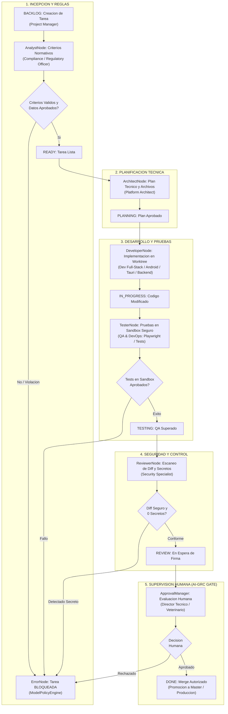

# Especificacion Tecnica: Orquestacion, Coordinacion y Supervision Multiagente
## Arquitectura Software Factory de Backend con IA y Mecanismos de Control

**Ambito:** Software Factory Hibrida Local y Microsoft Foundry (`sadogfarm.onmicrosoft.com`)  
**Proyecto de Referencia:** Livestock Manager  
**Fecha:** 27 de octubre de 2026  
**Version:** 1.0  

---

## 1. Mapa de Documentacion Tecnica del Sistema

La coordinacion, configuracion, workflow de trabajo y supervision de los agentes que intervinieron en el desarrollo de la aplicacion se encuentra integrada y documentada en los siguientes componentes tecnicos de la infraestructura:

| Documento / Fichero Tecnico | Localizacion | Proposito en la Arquitectura |
| :--- | :--- | :--- |
| **Marco AI-GRC y Taxonomia de Roles** | [docs/piloto_livestock_manager/AI_GOVERNANCE_RISK_COMPLIANCE.md](piloto_livestock_manager/AI_GOVERNANCE_RISK_COMPLIANCE.md) | Define formalmente los 9 roles, matriz de responsabilidades, niveles de autonomia (L1-L5) y politicas de contencion. |
| **Blueprint del Workflow y Fases** | [docs/piloto_livestock_manager/PILOT_BLUEPRINT_LIVESTOCK_MANAGER.md](piloto_livestock_manager/PILOT_BLUEPRINT_LIVESTOCK_MANAGER.md) | Especifica la progresion paso a paso de una tarea por los estados Kanban, desde `BACKLOG` hasta `DONE`. |
| **Configuracion Declarativa de Agentes** | [docs/piloto_livestock_manager/CONFIG_LIVESTOCK_MANAGER.yaml](piloto_livestock_manager/CONFIG_LIVESTOCK_MANAGER.yaml) | Catalogo tecnico de cuotas de tokens, modelos asignados (FCC / Azure Foundry), temperaturas y allowlists de binarios sandbox. |
| **Contrato de Datos y Fronteras** | [docs/piloto_livestock_manager/DATA_CONTRACT_LIVESTOCK.json](piloto_livestock_manager/DATA_CONTRACT_LIVESTOCK.json) | Diccionario formal de datos clasificando entidades entre `local_only`, `restricted` y `approved_remote`. |
| **Motor de Orquestacion Ejecutable** | [src/software_factory/orchestration/graph.py](../../src/software_factory/orchestration/graph.py) | Implementacion en codigo de la maquina de estados de LangGraph que coordina las llamadas y transiciones entre agentes. |
| **Barrera Humana de Supervision** | [src/software_factory/orchestration/approval.py](../../src/software_factory/orchestration/approval.py) | Punto de control obligatorio donde ningun agente tiene permiso de transicionar a `DONE` sin aprobacion humana auditada. |
| **Pasarela Cloud Gobernada** | [docs/INTEGRACION_MICROSOFT_FOUNDRY_SDOGFARM.md](INTEGRACION_MICROSOFT_FOUNDRY_SDOGFARM.md) | Integracion del tenant `sadogfarm.onmicrosoft.com` para inferencia empresarial auditada bajo el EU Data Boundary. |
| **Manifiesto y Ciclo de Vida en la App** | `LIVESTOCK-MANAGER/.software-factory/project.yaml` y `docs/AI_GRC_LIFECYCLE.md` | Puntos de contacto en el repositorio de la aplicacion que vinculan el codigo fuente con la factoria. |

---

## 2. Taxonomia y Asignacion de Competencias de los 9 Agentes

La arquitectura organiza a los agentes en cuatro capas funcionales para evitar solapamientos y prevenir que un solo sistema concentre privilegios de desarrollo y aprobacion:

```text
                       CAPA DE DIRECCION Y GOBIERNO
     +--------------------------------------------------------------+
     | [Project Manager] <----> [Compliance & Regulatory Officer]   |
     +------------------------------┬-------------------------------+
                                    |
     +------------------------------+-------------------------------+
     |                                                              |
     v                                                              v
CAPA DE ARQUITECTURA Y DISENO                      CAPA DE AUDITORIA Y SEGURIDAD
+---------------------------------------+          +-----------------------------+
| [System Architect & UI/UX Director]   |          | [Security & Privacy Auditor]|
+-------------------┬-------------------+          +--------------┬--------------+
                    |                                             |
                    v                                             v
       CAPA DE INGENIERIA Y DESARROLLO                CAPA DE CALIDAD Y DEVOPS
+---------------------------------------+          +-----------------------------+
| [Backend & Data Engineer]             |          | [QA Automation Engineer]    |
| [Frontend & PWA Developer]            |          | [DevOps & Release Engineer] |
| [Android / Capacitor Specialist]      |          +--------------┬--------------+
| [Windows / Tauri Native Specialist]   |                         |
+---------------------------------------+                         |
                                                                  v
                                                     CAPA DE SOPORTE Y DOCS
                                                   +-----------------------------+
                                                   | [Technical Writer & Support]|
                                                   +-----------------------------+
```

### Roles y Responsabilidades Detalladas

1. **Project Manager (`agent_pm`):**
   - **Competencia:** Incepcion de iniciativas, desglose de epicas en tareas atómicas, priorizacion y alimentacion del tablero Kanban.
   - **Control de Seguridad:** No tiene acceso de escritura sobre codigo fuente ni archivos de configuracion del sistema.
2. **Responsable de Cumplimiento Normativo y Auditor Interno (`agent_compliance`):**
   - **Competencia:** Auditoria legal contra regulaciones agropecuarias (RD 787/2023, RD 479/2004 REGA, SANDACH, SIGGAN Andalucia, BADIGEX Extremadura). Formula criterios de aceptacion que deben cumplirse de manera ineludible.
   - **Control de Seguridad:** Dispone de poder de veto preventivo; puede bloquear cualquier tarea si detecta violaciones normativas.
3. **Arquitecto de Plataforma y Diseno UI/UX (`agent_architect`):**
   - **Competencia:** Diseno tecnico desacoplado, modelado de bases de datos, especificacion de contratos TypeScript y cumplimiento del diseno Bento Grid y estandares visuales de `.agent/AGENTS.md`.
   - **Control de Seguridad:** Diseña el plan tecnico (`ArchitectPlan`) y define archivos afectados, pero no aplica cambios directamente en el repositorio.
4. **Desarrolladores Especializados por Plataforma (`agent_dev_*`):**
   - **Desarrollador Full-Stack / PWA (`agent_dev_frontend`):** Componentes Web, vistas HTML5, layouts modulares y sincronizacion Dexie.js / IndexedDB.
   - **Desarrollador Android (`agent_dev_android`):** Puente de integracion nativo Capacitor 7, comunicacion con lectores RFID, camara y sincronizacion offline en dispositivos moviles.
   - **Desarrollador Windows (`agent_dev_windows`):** Modulos nativos Tauri v2 (Rust / C++), APIs de Windows, empaquetado MSIX y rendimiento de escritorio.
   - **Desarrollador Backend (`agent_dev_backend`):** Servicios serverless en Cloudflare Workers (`livestock-manager-support-api`), esquemas relacionales y exportaciones oficiales.
   - **Control de Seguridad:** Cada desarrollador opera en su propio Git Worktree aislado (`.worktrees/task-xxx`). Prohibido tocar ramas compartidas o interactuar directamente con `master`.
5. **Ingeniero de QA y DevOps (`agent_qa_devops`):**
   - **Competencia:** Generacion y ejecucion de pruebas automatizadas (Playwright, Pytest, Cargo), verificacion de regresiones y empaquetado de artefactos.
   - **Control de Seguridad:** Ejecuta sus procesos estrictamente dentro del sandbox (`CommandExecutor`) con lista blanca de comandos y tiempo limite estricto.
6. **Especialista en Seguridad (`agent_security`):**
   - **Competencia:** Escaneo estatico de diffs con `SecretScanner` (deteccion de API keys, tokens JWT, credenciales privadas), analisis de dependencias y verificacion del contrato de datos.
   - **Control de Seguridad:** Transiciona automaticamente cualquier tarea al estado `BLOCKED` si detecta credenciales o violacion del aislamiento `local_only`.
7. **Responsables de Documentacion y Soporte al Usuario (`agent_docs_support`):**
   - **Competencia:** Redaccion de manuales tecnicos, manuales de usuario para ganaderos en campo, guias de actualizacion y clasificacion de incidencias de soporte.
   - **Control de Seguridad:** No tiene permisos de modificacion sobre la logica de negocio ni sobre esquemas de base de datos.

---

## 3. Workflow de Coordinacion en la Maquina de Estados (LangGraph)

El flujo operativo se orquesta mediante una maquina de estados formal implementada en `src/software_factory/orchestration/graph.py`:



---

## 4. Mecanismos de Control y Supervision en el Backend

1. **Persistencia Inmutable (SQLite WAL):**
   - Toda accion de un agente queda registrada en la base de datos `data/factory.db`.
   - La tabla `task_events` guarda: `task_id`, `from_status`, `to_status`, `agent_role`, `reason`, `metadata_json` y `timestamp`.
   - La tabla `audit_logs` almacena la firma digital y los argumentos de cada aprobacion humana.

2. **Aislamiento Físico de Entornos (Git Worktrees):**
   - El `WorktreeManager` crea un directorio independiente para cada tarea bajo `.worktrees/task-{id}`.
   - Ningun agente puede interferir con el codigo que esta desarrollando otro agente en paralelo.

3. **Sandbox con Lista de Comandos Permitidos (`CommandExecutor`):**
   - Solo se ejecutan binarios tipados expresamente: `git`, `pytest`, `python3`, `node`, `npm`, `npx` y `cargo`.
   - Limite de tiempo estricto por ejecucion y cuota maxima de salida de 1 MB para prevenir ataques de denegacion de servicio o bucles infinitos.

4. **Fronteras de Datos y Prevencion de Fugas (`ModelPolicyEngine`):**
   - Clasificacion estricta: si un prompt contiene identificadores marcados como `local_only` (codigos REGA, coordenadas GPS, certificados de explotacion), la pasarela aborta la peticion antes de emitir ninguna trama de red hacia FCC o Microsoft Foundry.

5. **Barrera Obligatoria de Aprobacion Humana (Human-in-the-Loop):**
   - El estado `REVIEW` es terminal para la IA: ningun modelo tiene permiso para transicionar a `DONE`.
   - La promocion final exige la intervencion explicita y auditada de un responsable humano con el rol de `director_tecnico_veterinario` o `responsable_cumplimiento_legal`.
