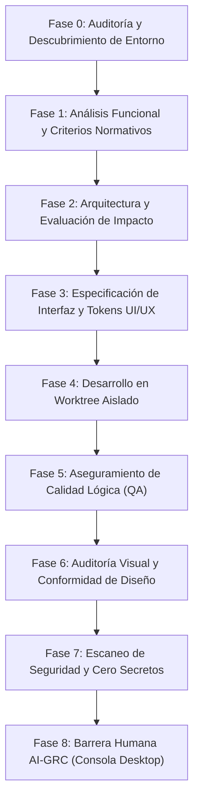

# Procedimiento Operativo Estándar: Gobernanza y Orquestación Multiagente (SOP-SF-001)

## 1. Objeto y Alcance

Este documento establece el marco normativo, técnico y operativo para la ejecución de ciclos de desarrollo asistidos por agentes de inteligencia artificial en la Software Factory de **Sdog Farm**. 

Aplica a todos los desarrollos, correcciones de errores, refactorizaciones y auditorías ejecutados sobre los repositorios del ecosistema, abarcando tanto proyectos de nueva creación (**Greenfield**) como sistemas en producción y código heredado (**Brownfield**).

---

## 2. Marco Normativo y Estándares de Referencia

Este procedimiento se fundamenta estrictamente en los estándares internacionales y especificaciones técnicas oficiales de los productos que componen la infraestructura:

1. **Gobernanza y Gestión de Riesgos de Inteligencia Artificial:**
   - **ISO/IEC 42001:2023:** Estándar internacional para Sistemas de Gestión de Inteligencia Artificial (AIMS), que exige trazabilidad inmutable de decisiones, segregación de funciones entre agentes y retención obligatoria de auditoría.
   - **NIST AI Risk Management Framework (AI RMF 1.0):** Funciones de Gobernanza (*Govern*), Mapeo (*Map*), Medición (*Measure*) y Gestión (*Manage*) de riesgos algorítmicos.
   - **Microsoft Responsible AI Standard (v2):** Principios de equidad, fiabilidad, seguridad, privacidad, inclusión, transparencia y responsabilidad (*Accountability*).

2. **Arquitectura y Control de Orquestación Multiagente:**
   - **LangGraph Multi-Agent Architecture (LangChain Oficial):**
     - Patrón de Supervisión y Enrutamiento Centralizado (*Supervisor Pattern*).
     - Límites deterministas de recursión (*Recursion Limits*) para erradicar bucles infinitos de autocorrección entre agentes.
     - Persistencia transaccional de estado mediante puntos de control (*Checkpointers*) basados en SQLite WAL.

3. **Sistemas de Diseño y Tokens de Interfaz:**
   - **W3C Design Tokens Community Group (DTCG Specification):** Estándar formal para desacoplar variables de color, tipografía, espaciado y elevación de los lenguajes de renderizado (CSS, JSON, XML).
   - **Google Android Accessibility & Material Design 3:** Directriz oficial de objetivos táctiles mínimos de **48x48 dp** y preservación de áreas seguras (*safe-area-insets*).
   - **Microsoft Fluent Design System:** Directriz oficial para aplicaciones de escritorio Windows/Tauri de alta densidad de información, contraste accesible (WCAG 2.1 AA) y atajos de teclado.

4. **Metodología de Mantenimiento de Software Heredado:**
   - **Software Engineering Institute (SEI) / Martin Fowler:** Principios de migración *Strangler Fig* y regla del *Boy Scout* (no-regresión y tolerancia progresiva en bases de código heredadas).

---

## 3. Matriz de Clasificación de Entornos y Arquetipos de Plataforma

Todo repositorio procesado por la factoría debe ser identificado unívocamente dentro de uno de los siguientes arquetipos técnicos:

| Arquetipo | Plataforma Diana | Repositorio de Referencia | Tecnologías Clave | Restricciones de Interfaz |
| :--- | :--- | :--- | :--- | :--- |
| **ARQ-01: Maestro Android / Móvil PWA** | Dispositivos móviles y tabletas Android | `LIVESTOCK-MANAGER` | Capacitor 7, PWA, Service Worker, IndexedDB | - Objetivos táctiles $\ge 48 \times 48\text{ dp}$.<br>- Safe areas inferiores y superiores.<br>- Navegación por barras inferiores o pestañas gestuales.<br>- Tokens de diseño en `docs/DESIGN_TOKENS.md`. |
| **ARQ-02: Piel ERP / Escritorio Windows** | Estaciones de trabajo Windows / Desktop | `AutonomousDevConsole` | Tkinter / Tauri, Python, SQLite WAL | - Alta densidad de datos (tablas, paneles Bento).<br>- Menús contextuales y atajos de teclado.<br>- Tipografía corporativa (Segoe UI, Consolas).<br>- Tokens de diseño en `docs/DESIGN_TOKENS.md`. |
| **ARQ-03: Core Backend / Microservicios** | Servidores locales, Linux y contenedores | `AutonomousDev` | Python 3.11+, FastAPI, Uvicorn, LangGraph | - Cero dependencias de interfaz gráfica.<br>- Endpoints REST tipados (Pydantic v2).<br>- Cobertura de pruebas unitarias $> 80\%$. |

---

## 4. El Ciclo de Vida Multiagente en 8 Fases



### Fase 0: Descubrimiento y Perfilado de Entorno (Environment Discovery Gate)
- **Agente Responsable:** `EnvironmentAuditorAgent` (Planificador).
- **Entrada:** Repositorio seleccionado en la consola.
- **Acciones:**
  1. Inspección estática del repositorio: detección de archivos de configuración (`capacitor.config.*`, `tauri.conf.json`, `package.json`, `pyproject.toml`).
  2. Búsqueda y lectura de `DESIGN_TOKENS.md` y `ARCHITECTURE.md`.
  3. Determinación del arquetipo de plataforma (`ARQ-01`, `ARQ-02`, o `ARQ-03`).
  4. Extracción de variables de estilo permitidas y restricciones de no-regresión.
- **Salida Obligatoria:** `PlatformBlueprint` inyectado en el estado compartido de LangGraph (`FactoryState`).

### Fase 1: Análisis Funcional y Criterios Normativos
- **Agente Responsable:** `AnalystAgent`.
- **Acciones:** Formulación de criterios de aceptación en formato Gherkin estructurado a partir del requerimiento o incidencia.
- **Transición Kanban:** De `BACKLOG` a `READY`.

### Fase 2: Arquitectura y Evaluación de Impacto
- **Agente Responsable:** `ArchitectAgent`.
- **Acciones:**
  1. Identificación estricta de archivos autorizados para modificación (lista blanca).
  2. Verificación de dependencias (prohibición de incorporar librerías `npm` o `pip` sin autorización explícita).
  3. Evaluación de riesgo (`BAJO`, `MEDIO`, `ALTO`, `CRITICO`).
- **Transición Kanban:** De `READY` a `PLANNING`.

### Fase 3: Especificación de Interfaz y Contrato UI/UX
- **Agente Responsable:** `UIUXAgent` (Modo Especificación).
- **Acciones:**
  - Si el proyecto incluye interfaz (ARQ-01 o ARQ-02): Genera el **Contrato de Interfaz** detallando variables CSS autorizadas, componentes maestros a reutilizar y reglas de diseño responsivo.
  - Si el proyecto es backend (ARQ-03): Esta fase se omite automáticamente (*Bypass* documentado).

### Fase 4: Desarrollo Aislado
- **Agente Responsable:** `DeveloperAgent`.
- **Acciones:**
  1. Creación de una rama git temporal y un worktree aislado (`.worktrees/task-<id>`).
  2. Implementación exclusiva dentro del alcance definido por las Fases 1, 2 y 3.
  3. Prohibición estricta de modificar ramas maestras o archivos protegidos de configuración de despliegue.
- **Transición Kanban:** De `PLANNING` a `IN_PROGRESS`.

### Fase 5: Aseguramiento de Calidad Lógica (QA)
- **Agente Responsable:** `TesterAgent`.
- **Acciones:**
  1. Ejecución de la suite de pruebas unitarias e integradas en sandbox local.
  2. Criterio de superación: **100% de tests aprobados** (`ALL_PASSED`). Cualquier fallo devuelve el código a la Fase 4 con informe de error detallado (máximo 1 reintento automático).
- **Transición Kanban:** De `IN_PROGRESS` a `TESTING`.

### Fase 6: Auditoría Visual y Conformidad de Diseño
- **Agente Responsable:** `UIUXAgent` (Modo Auditoría).
- **Acciones:**
  - Inspección del diff de estilos: verificación contra `DESIGN_TOKENS.md`.
  - Detección de transgresiones de ergonomía (touch targets en móvil, contraste cromático).
  - En proyectos *Brownfield*: Modo **Consultivo (Advisory)**; emite informe de sugerencias sin bloquear.
  - En proyectos *Greenfield*: Modo **Estricto**; rechaza el código si contiene estilos no autorizados.

### Fase 7: Seguridad y Escaneo de Secretos (Zero Secrets Gate)
- **Agente Responsable:** `ReviewerAgent`.
- **Acciones:**
  1. Escaneo algorítmico del diff completo mediante expresiones regulares y análisis de entropía (búsqueda de claves API, tokens JWT, contraseñas, URLs privadas).
  2. Criterio de superación: **0 secretos detectados**. Si se detecta 1 o más secretos, la tarea transiciona inmediatamente a `BLOCKED` y se genera una incidencia de seguridad de severidad `CRITICA`.
- **Transición Kanban:** De `TESTING` a `REVIEW`.

### Fase 8: Barrera Humana AI-GRC (Human-in-the-Loop)
- **Actor Responsable:** Director Técnico / Product Owner (Usuario Humano).
- **Entorno:** Consola Desktop Windows (`AutonomousDevConsole`).
- **Acciones:**
  1. Inspección del expediente técnico consolidado (criterios, plan arquitectónico, diff, informe de tests, evidencias visuales y reporte de seguridad).
  2. Emisión de decisión formal: `APROBADO` o `RECHAZADO`.
  3. Firma digital criptográfica SHA-256 registrada en `factory.db`.
  4. En caso de aprobación: Promoción a producción mediante merge formal de la Pull Request hacia la rama `master`.
- **Transición Kanban:** De `REVIEW` a `DONE`.

---

## 5. Política Diferenciada: Greenfield frente a Brownfield

```
                              TIPO DE REPOSITORIO
                                       │
                  ┌────────────────────┴────────────────────┐
                  ▼                                         ▼
        PROYECTO GREENFIELD                       PROYECTO BROWNFIELD
       (Nueva Creación / v0)                    (En Producción / Legacy)
  ───────────────────────────────           ────────────────────────────────
  - Sistema de diseño canónico              - Tolerancia de no-regresión
  - Cumplimiento estricto tokens            - Respeto a estilos del entorno
  - Tests obligatorios desde inicio         - Aislamiento de código nuevo
  - Zero-tolerance en linters               - Modo UI/UX consultivo (advisory)
```

1. **Proyectos Greenfield (Nuevos desde Cero):**
   - El `EnvironmentAuditorAgent` inicializa de forma obligatoria la plantilla de `DESIGN_TOKENS.md` correspondiente al arquetipo seleccionado.
   - Las fases de auditoría operan bajo modo estricto. Cualquier estilo inline no parametrizado o función sin test unitario detiene el ciclo.

2. **Proyectos Brownfield (Existentes en Producción):**
   - El principio rector es la **No-Regresión Absoluta (Zero Breaking Changes)**.
   - La factoría no fuerza la reescritura de código legacy ni la migración de estilos globales.
   - El código nuevo se diseña preferentemente como **Servicio Puro Desacoplado** (como se demostró en `porcine-traceability.js`), garantizando que la aplicación productiva continúe operando sin alteraciones.

---

## 6. Procedimiento de Control de Fallos y Antipatrones

Para garantizar la estabilidad operativa del sistema:

1. **Límite de Recursión (Anti-Thrashing):**
   - Ninguna tarea podrá iterar más de **2 veces** de forma automática entre el desarrollador y los agentes de pruebas/auditoría.
   - Al alcanzar la segunda iteración sin éxito, el sistema transiciona la tarea a `BLOCKED` y crea una incidencia operacional en la base de datos.

2. **Segregación Inmutable de Privilegios:**
   - Ningún agente de inteligencia artificial posee permisos directos para realizar `git push origin master` o `gh pr merge`.
   - La operación de merge y despliegue a producción requiere invariablemente la interacción física del operador humano a través del botón de la consola desktop.

3. **Inmutabilidad de Auditoría (SQLite WAL):**
   - Los registros de `task_events` y `audit_logs` no admiten sentencias `UPDATE` ni `DELETE`. Todo evento es un registro acumulativo temporalmente ordenado.

---

## 7. Aprobación y Vigencia

- **Versión:** 1.0.0
- **Fecha de Aprobación:** 27 de Octubre de 2026
- **Ámbito:** Sdog Farm Software Factory (sadogfarm.onmicrosoft.com)
- **Marco de Control:** AI-GRC Console Platform
