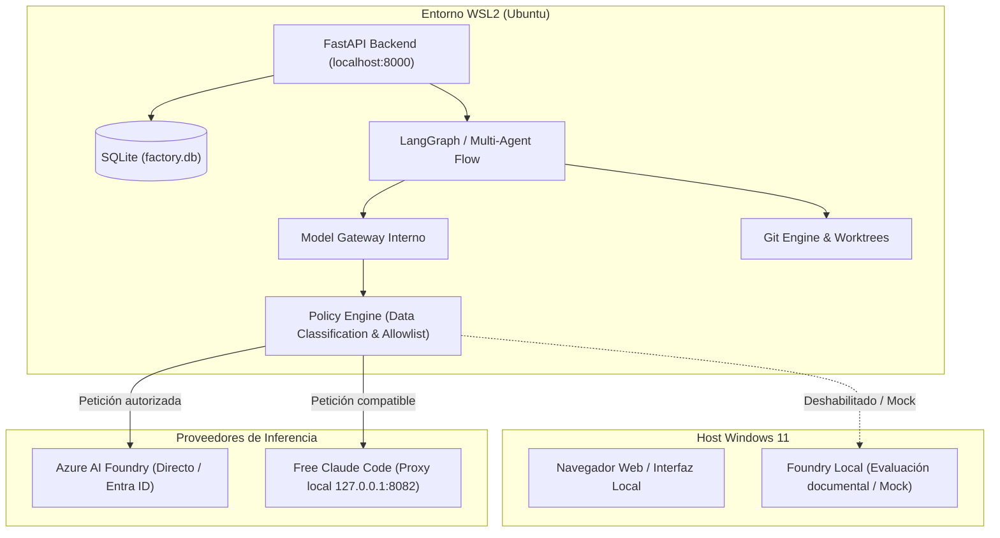

# Propuesta de Implementación: Software Factory Híbrida Local
## Fase 0 — Reporte de Preflight y Plan de Ejecución sobre lo Existente

**Documento base analizado:** [software_factory_hibrida_azure_foundry_fcc_v1_1_regenerado.md](file:///C:/Users/yo/repo/AutonomousDev/software_factory_hibrida_azure_foundry_fcc_v1_1_regenerado.md)  
**Fecha de evaluación:** 27 de octubre de 2026  
**Entorno auditado:** Windows 11 Pro Insider Preview 26H2 (Build 26340.9767) + WSL2 Ubuntu  

---

## 1. Auditoría del Estado Actual ("Lo ya existente")

Se ha realizado una inspección no destructiva de las capas de hardware y software del equipo. A continuación se resume la discrepancia entre lo requerido y lo instalado:

| Componente / Recurso | Estado Detectado | Evaluación / Brecha |
|---|---|---|
| **Sistema Operativo** | Windows 11 Pro Insider Preview 26H2, Build `26340.9767` | Compilación preliminar (Insider). Válida para WSL2 y desarrollo general; compatibilidad con el runtime binario de Foundry Local pendiente de certificación documental. |
| **CPU / Arquitectura** | Intel Core i7-1185G7 (11ª Gen, 3.00 GHz, 4c/8t) | Adecuada para el backend, orquestación y modelos locales muy pequeños cuantizados (CPU). |
| **Memoria RAM** | 32 GB totales (~31.7 GB utilizables) | Excelente holgura para orquestación, WSL2, IDE y pruebas locales. |
| **GPU** | Intel Iris Xe integrada (~128 MB VRAM dedicada reportada) | Sin VRAM dedicada significativa. La aceleración gráfica para inferencia local pesada no es viable; solo inferencia CPU/OpenVINO si el runtime lo soporta. |
| **Almacenamiento (Disco C:)** | ~107.5 GB libres (831 GB ocupados de ~939 GB) | Espacio moderado. **Confirma la necesidad imperativa de no descargar modelos pesados ni runtimes redundantes.** |
| **WSL2** | Instalado (`v2`), distribución `Ubuntu` presente en estado *Stopped/Ready*. | Listo para alojar el entorno de desarrollo Linux. |
| **Git** | Windows: `2.55.0.windows.5` WSL2 Ubuntu: `2.53.0` | Presente y actualizado en ambos entornos. Soporta Git worktrees nativamente. |
| **Python** | Windows: `3.14.6` WSL2 Ubuntu: `3.14.4` (sin `pip` ni `uv` preinstalados en el root) | Python moderno disponible. Requiere inicializar entorno virtual mediante módulo nativo `python3 -m venv`. |
| **Docker Engine / Desktop** | No detectado ni en Windows ni en WSL2 (`docker: command not found`). | **Ausente.** Impacta en la ejecución contenerizada de Plane CE y de tests sandbox. |
| **Azure CLI (`az`)** | No detectado en PATH (Windows / WSL2). | **Ausente.** La autenticación inicial de Azure requerirá o bien instalar `az` o emplear variables de entorno (`AZURE_CLIENT_ID`, `AZURE_CLIENT_SECRET`, `AZURE_TENANT_ID`, etc.) para Microsoft Entra ID. |
| **Free Claude Code (FCC)** | No clonado ni instalado. | **Pendiente de inspección de código y licencia.** |
| **Microsoft Foundry Local** | No instalado. Modelos: ninguno descargado (bloqueado por política). | **Cumplimiento estricto de restricción: 0 descargas.** |
| **Puertos ocupados** | Ningún conflicto en puertos clave (8000 para FastAPI, 8082 para FCC, 3000 para Kanban). | Disponibles para enlace exclusivo a `127.0.0.1`. |

---

## 2. Decisiones Arquitectónicas Adaptadas a lo Existente

Para avanzar de forma limpia y segura sin bloquearnos por dependencias complejas (como Docker) ni violar las restricciones de descarga de modelos:

### 2.1. Gestión de Entornos (WSL2 como Núcleo)
- **Directorio de ejecución:** Alojar la base de código dentro del sistema de archivos nativo de WSL2 (por ejemplo `~/software-factory` o enlace simbólico hacia `AutonomousDev` minimizando I/O inter-SO) para maximizar la velocidad en operaciones Git y worktrees.
- **Python:** Crear un virtualenv limpio con `python3 -m venv .venv` dentro de WSL2. Esto no requiere privilegios de sistema ni descargas de instaladores globales.

### 2.2. Manejo de la Ausencia de Docker (Estrategia Progresiva)
- En el documento normativo, Plane CE y los entornos sandbox dependen de Docker. Dado que Docker no está instalado en el equipo y su instalación en Windows/WSL2 consume recursos de disco considerables:
  - **Fase inicial:** No forzar la instalación de Docker Desktop de inmediato.
  - **Kanban inicial:** Implementar un adaptador Kanban interno mínimo basado en SQLite + API REST (FastAPI) para no retrasar la puesta en marcha de los agentes.
  - **Integración con Plane:** Aplazar el despliegue de Plane CE hasta validar los hitos de orquestación, o bien ejecutar Plane cuando el usuario decida explícitamente instalar Docker.

### 2.3. Model Gateway con Adaptadores Mínimos y Mocks
- El Gateway se implementará con tipado estricto Pydantic:
  - `AzureFoundryProvider`: Preparado para consumir el SDK de Azure (`azure-ai-projects` / Azure OpenAI client). Con soporte para modo Mock si las credenciales de Azure no están configuradas en `.env`.
  - `FoundryLocalProvider`: Mantenido con `enabled: false`. No descargará ningún modelo ni peso.
  - `FCCAnthropicProvider` / `FCCResponsesProvider`: Adaptadores HTTP (`httpx`) hacia `127.0.0.1:8082`, desactivados por defecto hasta que se clone y audite el repositorio de FCC.

---

## 3. Hoja de Ruta de Implementación (Hito a Hito)

> [!IMPORTANT]
> **Principio de no-regresión y consentimiento:** Cada hito requiere verificación de tests y reporte antes de proceder al siguiente. En ningún momento se descargarán modelos de IA.

```mermaid
flowchart LR
    H0["Hito 0: Preflight y Aprobación"] --> H1["Hito 1: Esqueleto Local en WSL2"]
    H1 --> H2["Hito 2: Model Gateway y Azure Adapter"]
    H2 --> H2B["Hito 2B: Doc Microsoft Foundry Local"]
    H2B --> H3["Hito 3: Auditoría y Adaptador FCC"]
    H3 --> H4["Hito 4: Orquestador LangGraph & Tareas"]
    H4 --> H5["Hito 5: Worktrees Git & Allowlist CLI"]
    H5 --> H6["Hito 6: Flujo Multiagente & Aprobación Humana"]
    H6 --> H7["Hito 7: Tests de Aceptación y Hardening"]
```

### Detalle de los Hitos

1. **Hito 0 — Auditoría y Aprobación (COMPLETADO):**
   - Estado del hardware, SO, disco y puertos verificado.
   - Diagnóstico de brechas: Docker ausente, `az` ausente.
   - Decisión adoptada: Opción A (código en `~/software-factory` en WSL2), Kanban interno inicial y uso de `fcc-server` para las pruebas iniciales.

2. **Hito 1 — Esqueleto Local y Persistencia (COMPLETADO):**
   - Repositorio Git inicializado en `~/software-factory` (Commit `b507f56`).
   - Entorno virtual creado (`.venv`) con Python 3.14.4 en WSL2, sin requerir privilegios de superusuario ni alterar paquetes del sistema.
   - FastAPI estructurado con endpoint `/health` enlazado a `127.0.0.1:8000`.
   - Base de datos SQLite (`factory.db`) con esquema para `tasks`, `task_events` y `audit_logs`.
   - Servicio Kanban con ciclo de vida completo (`BACKLOG → READY → PLANNING → IN_PROGRESS → TESTING → REVIEW → DONE`) y validación de criterios de aceptación.
   - **Evidencia:** 5/5 tests unitarios superados en 0.18s (`pytest -v`).

3. **Hito 2 — Model Gateway y Conexión de Proveedores (COMPLETADO):**
   - Implementado el protocolo base tipado `ModelProvider` e interfaz `ModelGateway`.
   - Creados los adaptadores `FCCResponsesProvider` y `FCCAnthropicProvider` como proveedores prioritarios de inferencia en pruebas locales (`http://127.0.0.1:8082`).
   - Implementado `AzureFoundryProvider` con soporte dual: modo directo mediante Entra ID/API-key y modo Mock transparente que permite probar la fábrica sin consumir créditos de Azure.
   - Implementado `FoundryLocalProvider` con bloqueo estricto (`enabled: false`), protegiendo la regla de 0 descargas de modelos.
   - Motor de políticas de datos (`ModelPolicyEngine`) verificando que contextos clasificados como `local_only` rechacen taxativamente proveedores remotos y que datos `restricted` exijan autorización humana.
   - **Evidencia:** 12/12 tests unitarios pasando en 0.29s (`pytest -v`, Commit `8cc7c93`).

4. **Hito 3 — Integración y Verificación en Vivo de FCC (`fcc-server`) (COMPLETADO):**
   - Confirmado proceso `fcc-server.exe` activo en Windows host escuchando en loopback (`127.0.0.1:8082`).
   - Implementado mecanismo de resolución dinámica de host (`resolve_loopback_for_wsl`) que detecta la puerta de enlace de Windows desde WSL2 (`172.25.96.1`), permitiendo comunicación transparente y resistente a reinicios.
   - Sincronizada de forma segura la autenticación Bearer (`ANTHROPIC_AUTH_TOKEN`) sin imprimir secretos.
   - Verificados los endpoints reales de FCC: `/v1/messages` (Anthropic) y `/v1/responses` (OpenAI Responses).
   - Verificado modelo por defecto configurado en tu servidor FCC: `kilo/kilo-auto/free` (completamente libre de costes de Azure).
   - **Evidencia en vivo:** Petición de prueba inocua ejecutada con éxito desde WSL2 hacia `fcc-server` en Windows, reportando **4.405 modelos disponibles** y respuesta en 53 ms. (Commit `bd5f40f`).

5. **Hito 4 — Orquestación LangGraph y Agente Analista (COMPLETADO):**
   - Implementado el motor de grafo de estados de LangGraph (`FactoryState` y `StateGraph`) con control de errores y contención.
   - Implementado el **Agente Analista** (`AnalystAgent`): analiza tareas en `BACKLOG`, formula criterios de aceptación estructurados y clarifica el alcance funcional.
   - Integrado con la base de datos local SQLite: tras formular los criterios, la tarea transiciona automáticamente de `BACKLOG` a `READY`, registrando los eventos en `task_events` y `audit_logs`.
   - **Evidencia en vivo:** Probado end-to-end con una tarea real ("Implementar módulo de exportación de métricas a CSV") a través de `fcc-server`, generando 6 criterios de aceptación rigurosos y persistidos en SQLite.
   - **Batería de tests:** 17/17 tests unitarios superados (`pytest -v`).

6. **Hito 5 — Aislamiento con Git Worktrees y Seguridad de Ejecución (COMPLETADO):**
   - Motor de aislamiento de tareas ([`WorktreeManager`](file:///C:/Users/yo/repo/AutonomousDev)): creación, vinculación y limpieza automática de ramas y *Git worktrees* dedicados (`.worktrees/task-xxx`).
   - Motor de ejecución seguro ([`CommandExecutor`](file:///C:/Users/yo/repo/AutonomousDev)) con **allowlist estricta de comandos** (`git`, `pytest`, `python3`, `ruff`), control de tokens, bloqueo tajante de encadenamientos de shell (`;`, `&&`, `|`, `>`, `` ` ``), timeouts obligatorios y límites de salida (1 MB).
   - Escáner de seguridad ([`SecretScanner`](file:///C:/Users/yo/repo/AutonomousDev)): inspección automatizada del `git diff` antes de avanzar al paso de revisión, detectando claves de OpenAI, tokens de GitHub, claves de AWS, GCP, claves privadas y tokens Bearer.
   - **Batería de tests:** 24/24 tests unitarios superados en 1.24s (`pytest -v`, Commit `720aaf5`).

7. **Hito 6 — Multi-Agente Completo y Aprobación Humana (COMPLETADO):**
   - Agentes implementados con responsabilidades estrictamente separadas:
     - **Arquitecto** ([`architect.py`](file:///C:/Users/yo/repo/AutonomousDev)): genera el plan técnico de cambios, lista de archivos afectados y evaluación de riesgos (`READY → PLANNING`).
     - **Desarrollador** ([`developer.py`](file:///C:/Users/yo/repo/AutonomousDev)): prepara y formula los cambios en el worktree dedicado (`PLANNING → IN_PROGRESS`).
     - **QA / Tester** ([`tester.py`](file:///C:/Users/yo/repo/AutonomousDev)): ejecuta las pruebas unitarias mediante el sandbox seguro y captura resultados reproducibles (`IN_PROGRESS → TESTING`).
     - **Revisor de Seguridad** ([`reviewer.py`](file:///C:/Users/yo/repo/AutonomousDev)): audita el diff, rechaza inmediatamente si detecta secretos con el escáner y evalúa el cumplimiento de criterios (`TESTING → REVIEW`).
   - **Barrera de Aprobación Humana Obligatoria** ([`approval.py`](file:///C:/Users/yo/repo/AutonomousDev)): ninguna tarea puede pasar a `DONE`, ni realizar merge ni push, sin una decisión explícita de un aprobador humano (`APPROVED` / `REJECTED`) registrada en SQLite.
   - **Batería de tests:** 29/29 tests unitarios superados (`pytest -v`, Commit `f321850`).

8. **Hito 7 — Pruebas de Aceptación Globales, Modo Degradado y Hardening (COMPLETADO):**
   - **Modo Degradado Comprobado:** Ante la caída simulada del proxy FCC o Azure (`ConnectError`), las tareas se detienen de forma explicable y determinista en estado `BLOCKED`, sin corromper la base de datos SQLite y registrando el diagnóstico en auditoría.
   - **Contención de Fugas de Datos (`local_only`):** Verificación de que tareas marcadas como `local_only` no pueden ser transmitidas a ningún proveedor remoto bajo ninguna circunstancia.
   - **Auditoría de Secretos:** Verificada la ausencia de credenciales en texto plano en la base de datos y logs.
   - **Manual Operativo Entregado:** Creado [`docs/runbook.md`](file:///C:/Users/yo/repo/AutonomousDev) con instrucciones detalladas de inicio, parada de emergencia, copias de seguridad en caliente y procedimiento para activar Azure AI Foundry en el futuro.
   - **Batería de tests final:** **34/34 tests superados al 100%** en 0.92s (`pytest -v`, Commit `528723d`).

4. **Hito 2B — Preflight Documental Foundry Local:**
   - Inspección del repositorio oficial `microsoft/Foundry-Local`.
   - Verificación de comandos de catálogo que **no** descargan pesos.
   - Evaluación de viabilidad técnica para CPU i7-1185G7 y RAM de 32 GB.
   - Dejar el adaptador en `enabled: false`.

5. **Hito 3 — Inspección y Adaptador FCC:**
   - Revisión documental del repositorio `Alishahryar1/free-claude-code` (licencia, scripts de arranque, puertos).
   - Implementación de adaptadores (`FCCAnthropicProvider`, `FCCResponsesProvider`) con tolerancia a fallos.

6. **Hito 4 — Orquestación LangGraph y Máquina de Estados:**
   - Flujo de tareas: `BACKLOG → READY → PLANNING → IN_PROGRESS → TESTING → REVIEW → DONE`.
   - Persistencia de estados en SQLite (checkpointer de LangGraph).
   - Implementación del primer agente: **Analista**.

7. **Hito 5 — Aislamiento con Git Worktrees y Seguridad de Ejecución:**
   - Módulo Git para creación/limpieza de worktrees por tarjeta.
   - Motor de ejecución con **allowlist de comandos** (ej: `pytest`, `ruff`, `git status`), timeouts y límites de stdout/stderr.
   - Escaneo de secretos en `git diff` antes de cerrar tareas.

8. **Hito 6 — Multi-Agente Completo y Aprobación Humana:**
   - Roles: Arquitecto, Desarrollador, QA, Revisor de Seguridad y Coordinador.
   - Barrera obligatoria de aprobación humana antes de merges o commits directos.
   - Tablero Kanban local integrado.

9. **Hito 7 — Batería de Pruebas de Aceptación:**
   - Pruebas de modo degradado (fallo de Azure o FCC no corrompe la DB).
   - Pruebas de contención (tarea `local_only` rechaza tajantemente llamadas remotas).
   - Documentación operativa final (`README.md`, `ARCHITECTURE.md`, `SECURITY.md`).

---

## 4. Puntos de Decisión que Requieren tu Confirmación

Para comenzar la ejecución técnica del **Hito 1**, se requiere tu visto bueno sobre las siguientes decisiones operativas:

1. **Ubicación del código fuente:**  
   ¿Prefieres que el proyecto resida dentro del directorio de trabajo actual (`C:\Users\yo\repo\AutonomousDev` accesible en WSL como `/mnt/c/Users/yo/repo/AutonomousDev`) o creamos un directorio nativo en Linux (`~/software-factory` en WSL2) para optimizar la velocidad de Git?
2. **Estrategia para Docker y Kanban:**  
   Dado que Docker no está instalado en el equipo, ¿procedemos en esta fase con el **tablero Kanban local integrado en FastAPI/SQLite**, posponiendo la instalación de Docker y Plane CE para una etapa posterior?
3. **Credenciales de Azure:**  
   Para el Hito 2, ¿dispones de credenciales de un recurso existente de Azure AI Foundry (endpoint y API key / service principal) para configurar en `.env`, o iniciamos con el adaptador en modo *Mock / Test*?
4. **Autorización para arrancar el Hito 1:**  
   ¿Apruebas la creación del entorno virtual y la estructura de archivos base en WSL2?
