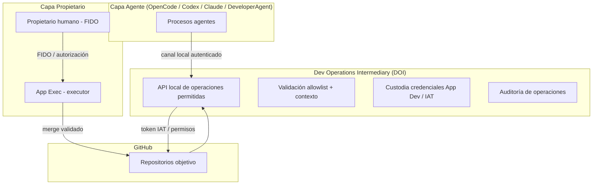

# P1-A3 — Cierre de requisitos y matriz de aceptación del Dev Operations Intermediary (DOI)

**Proyecto:** Owner Authorization / Dev Operations Intermediary
**Fase:** Fase 1 — P1-A3: Cierre de requisitos y matriz de aceptación del DOI
**Base previa:** P1-A2 — Especificación técnica del intermediario de operaciones Dev
**Alcance:** documentación y requisitos técnicos. Sin implementación.

## 1. Propósito

Transformar la especificación P1-A2 en requisitos técnicos verificables y cerrar la matriz de aceptación del Dev Operations Intermediary (DOI), sin implementar código.

## 2. Arquitectura actual (actualizada)

## 3. Requisitos técnicos del DOI

| ID | Requisito | Origen (P1-A2) | Prioridad | Verificación | Estado |
|----|---|---|---|---|---|
| REQ-DOI-001 | El DOI debe operar como servicio local con identidad de servicio diferenciada. | P1-A2 §7 | Alta | Prueba de aislamiento | Diseñado |
| REQ-DOI-002 | El DOI debe mantener allowlist positivo de operaciones GitHub; denegar por defecto. | P1-A2 §5.2 | Alta | Matriz endpoints | Diseñado |
| REQ-DOI-003 | El DOI debe rechazar operaciones de merge (REST, async, GraphQL, gh, integración). | P1-A2 §5.4 / informe correctivo | Alta | Pruebas negativas/bypass | Diseñado |
| REQ-DOI-004 | El DOI debe revalidar repo/contexto/SHA/PR por operación. | P1-A2 §5.3 | Alta | Validación params | Diseñado |
| REQ-DOI-005 | El DOI debe custodiar credenciales App Dev (clave, JWT/IAT, DPAPI/ACL, aislamiento). | P1-A2 §7 | Alta | Custodia | Diseñado |
| REQ-DOI-006 | El agente no debe poseer credencial App Dev; canal autenticado hacia DOI. | P1-A2 / corrección | Alta | Aislamiento | Diseñado |
| REQ-DOI-007 | Fail-closed ante fallos. | P1-A2 | Alta | Pruebas | Diseñado |
| REQ-DOI-008 | Branch protection + restricciones escritura (target branch, creation, ref update, force push, deletion). | P1-A2 / propietario | Alta | Rama protegida | Diseñado |
| REQ-DOI-009 | Auditoría de operaciones sin secretos. | P1-A2 §9 | Media | Auditoría | Diseñado |
| REQ-DOI-010 | Rate/size limits, expiración, nonce, replay. | P1-A2 / contrato API | Media | Validación | Diseñado |

## 4. Criterios de aceptación del DOI

- Ningún requisito crítico queda descrito únicamente como prohibición operativa.
- Cada amenaza tiene mitigación y prueba verificable.
- La App Dev no puede integrar cambios.
- La App Dev no puede escribir directamente en ramas protegidas.
- No existe camino alternativo de acceso a credenciales.
- El comportamiento ante fallos es siempre denegar, nunca permitir por defecto.

## 5. Estado

Diseñado. Sin implementación, sin credenciales, sin Apps.
